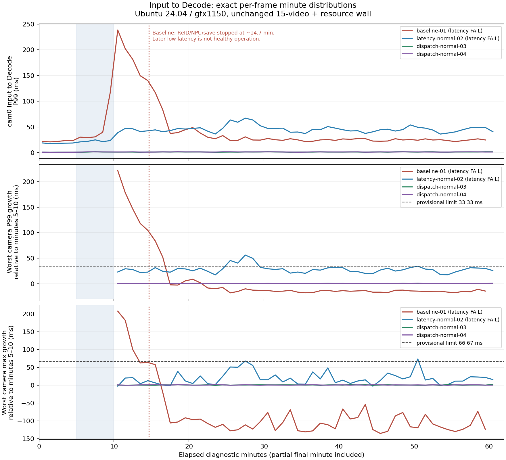

<!-- source: docs/dev/nvr/input-decode-latency.md 9f3c9597118dad6efe13eaeb5e077a1a82bf033d -->
# Input→Decode遅延の調査

## ライブ表示の停止回避（2026-11-16）

ライブ表示は最新映像への追従を優先します。3枚の表示FIFOが満杯になった場合は、まだ取り出されていない最古のフレームを捨て、新しいフレームを受け入れます。初期蓄積は2フレーム周期のままです。表示時刻が大幅に遅れた場合は滞留分を破棄して追従し、起動直後の集中到着でも表示予定が先へ伸び続けないよう補正します。描画・GPU処理中のサーフェスは完了確認前に再利用しません。

ライブ表示を初めて開始してから10秒未満の破棄はdrop集計から除外します。この除外期間は全カメラ共通で、再接続・表示再開では延長しません。起動時の破棄もフレーム診断には残し、presentation_startup_dropとして区別します。10秒以降の表示破棄はタイルの1行表示に drop N、AI Statisticsに合計件数を表示し、通常ログにもカメラ別に記録します。実表示通知での破棄も別イベントとして数えます。latency 10s maxは実際に表示されたフレームのみの値であり、低い値だけで取りこぼしがないとは判断できません。録画経路・保持期間・AI頻度は変更していません。

診断解析の --allow-live-drops は明示的な表示破棄を照合しますが、全フレーム表示の合格にはしません。既定の厳密な検査は維持します。不正なPTSやデバイス障害は隠しません。以下の過去の「満杯時100msで停止」「破棄なし」の説明は当時の方式で、現在のライブ表示方針は本節が優先します。

Ubuntu 24.04/gfx1150の通常構成で、録画・DB待ちから独立した直接投入が長時間試験2回に合格しました。観測したInput→Decode増加の原因は保存・制御経路との結合です。同コミット時点の表示側破棄と匿名RSS増加は別途記録しています。後述の表示FIFOとQt比較は後続の実験です。[最終レビュー](input-decode-results/dispatch-final-review.json)を参照してください。

受信・フレーム組み立て、入力キュー、デコーダーのpad間、デコード後の受け渡し、表示を分けて調べます。デコーダー出口の時刻はVAハードウェアの処理完了を保証しません。既存の`Decoded frame wait`と表示用縮小時間も確認します。追加のGPU同期や画像のCPU読み出しは行いません。

## 任意の診断記録

`scripts/env.sh`を読み込んでから、`AMDVA_DIAGNOSTICS_DIR`に新しい出力先を指定して通常のGUIデモを起動します。未指定なら追加記録を無効にします。設定済みのAI頻度・録画・sysfs GPU計測は維持します。`AMDVA_DIAGNOSTICS_TRACE=0`ではフレーム単位の記録だけを止め、同じ定期状態記録を残して計測負荷を比較できます。設定の変更には再起動が必要です。

- `events.csv`は単調時刻ns、入力名、世代、連番、イベント、2つの整数値、PTSを記録します。文字列はバックスラッシュでエスケープする引用形式です。Pythonでは`csv.DictReader(..., escapechar='\\', doublequote=False)`で読みます。
- 正常な0、時刻・PTSの不連続を修正せずに保存します。入力・世代ごとに比較します。
- `appsrc_queue`・`ingest_queue`の値はバイト数と枚数、`appsrc_time`・`ingest_oldest_age`はnsです。滞留時間の不明値は-1です。
- `decoded_lock`はロック待ち、`handoff`は保持中の処理時間、`preview_lock`は待ち・保持時間を記録します。`preview_scale`は既存の同期待ちも含み、GPU実行時間だけを表しません。
- `status.jsonl`に5秒ごとのカメラ進捗・既存の時間分布・AI完了件数と待ち状態を保存します。既存の時間分布は移動窓の値であり、正確な1分ごとのP99・最大値はフレーム記録から計算します。
- 65,536イベントの有界キューから別スレッドで書き出します。フレーム処理側ではファイルI/Oを行いません。イベントファイルの上限は1試験4GiBです。
- 正常終了時の`diagnostics-summary.json`に受付・書込・キュー超過・ファイル上限超過・未書込件数と書込失敗を保存します。summary不足、記録欠落、書込失敗がある場合は厳密なフレーム照合を不成立とします。

`counter`の件数をそのまま動画の欠落数とは扱いません。特に期限切れには古い対応付け情報の破棄も含まれます。デコーダーへの投入と出力は入力・世代・連番で照合し、録画専用入力、起動・終了区間、既存の表示上書きは区別します。

## 再現と合否

15カメラ＋リソース画面の配置を固定します。起動前にソース・設定のハッシュと既存証跡を保存します。現在のGUIは起動時に旧録画カタログを消すため、NVR停止中に動画は同一FSのハードリンク、カタログはSQLiteバックアップAPIで別に保全します。

短時間のフレーム記録無効／有効比較後に60分の基準試験を実施し、CPU・RSS・DRM割り当て・FD・ディスクI/O・カーネル警告も外部記録します。修正は一要因ずつ比較し、最後に通常構成で60分を2回確認します。5～10分を基準とし、その後の入力別・1分区間のP99増加を1フレーム周期以内、最大値増加を2周期以内とします。フレーム破棄やAI頻度低下によって達成しません。既存の表示破棄は別に報告し、全フレーム表示の保証とは扱いません。

FIFO実装は次段階です。遅延増加の解消後に残るジッター、明示的な満杯時の扱い、VAサーフェス容量から枚数を決めます。実機結果と原因の結論は別途記録し、診断追加や未再現だけを修正成功とは扱いません。

## 監査範囲とVPE実行の確認

通常GUIは、要求されたCPUコピー監査をモデル準備後に開始します。開始時刻と
稼働中のカウンタ、処理スレッド終了後の `copy-audit-summary.json` を保存します。
ライブラリの事前読込だけでは監査は有効になりません。初期のGUI調査試験は
読込だけだったため、コピー監査済みとは認定しません。

`VaSession::crop_scale` は `scripts/env.sh` が読み込む投入監査を必須とします。
一つの既存VA処理をdisplay・VA context・出力surfaceで識別します。
Mesaは別スレッドから非同期投入し、異なるVA contextでカーネルcontextを共有するため、
呼出元スレッドやカーネルcontext番号だけでは処理を区別できません。
監査では、成功したVPE専用コマンド投入の出力binary syncobjを、対象surfaceに対する
既存の完了待ちと照合します。成功したvaBeginPicture・vaSyncSurfaceも必須とし、
古いフェンスや他の処理が確認に使用済みのフェンスを成功扱いしません。
対応を確認できない経路は明示的に失敗します。使用時間カウンタの待機、同じ縮小の
再試行、追加GPUコマンド・同期、モデル間の共通GPUロックは導入しません。
有界のメタデータだけを扱い、画像や間接バッファ内のコマンド内容は読みません。
未対応のフェンス形式を使うドライバー経路は、検証して対応するまで停止します。

監査モジュールは、このcheckoutに属するチェックサム別のスナップショットから
読み込みます。ビルド用プロセスに読込済みのライブラリを上書きすることを防ぎます。
再ビルド後は環境を読み直します。CPUコピー監査を追加する直接起動でもVPEの事前読込を
維持してください。GPU・NPUランチャーは共通ヘルパーで同じ選択規則を使用します。

`vpe-audit-summary.json` は処理の投入範囲・確認完了・失敗・中断・実行中件数、
カーネル投入の成功・拒否、監査メタデータ待ち時間を記録します。
フレーム・進捗検証に加えて `python3 scripts/latency/validate_audits.py TRIAL_DIRECTORY` を実行します。
通常起動の正常終了、CPUコピー監査の有効時間60分以上、全VPE処理の確認、失敗0・残処理0を
最終受入条件とします。summaryがなければ未完了です。両監査は独立した確認です。

## amd-rai370での原因比較

11月13日の60分試験で遅延を再現しました。録画削除時の `control_quota` が約241msに達し、
次の入力受け渡しまで制御スレッドを待たせていました。入力→AUは短い一方、AU→decoderと
入力最古滞留時間が増加しました。動画の600秒ループも同時期のため、それだけで原因を
断定せず、後続試験では削除処理自体を区間計測しました。

メタデータ容量は全件SUMの繰り返しから、同じトランザクション内で正確に更新する
カウンタへ変更しました。削除SQLの索引範囲も、元のセッション・時刻境界を維持します。
それだけでは容量制御に約46～64msが残りました。次の候補は同じ削除とincremental vacuumを
一つのトランザクションで確定します。FULLの耐久性、上限・空き容量・保持期間、録画中・
再生中保護は維持し、確定後に空き容量を再確認します。失敗時にメタデータをrollbackしますが、
ファイルのunlink自体は元実装同様にrollbackできません。長時間の受入は未完了です。

別途、20ms以内のVPE使用時間増加を必須とする判定でReIDが停止しました。実動画フレームの
単独試験ではROI前処理20,000回と実VPE投入20,001回を観測しました。ユーザー承認の上で
前述の投入・完了フェンス監査へ移行しますが、過去の失敗すべてが誤検知だったという証明では
ありません。一候補ではWaylandの終了処理で中断し、診断summaryが残りませんでした。
短いデバッガー試験では再現せず、独立した検証課題として残しています。原因確定や照合成功とは
扱いません。

## 補助VA contextと検証範囲

一度でもcrop/scale監査を開始したVA contextは、その後の処理にも個別のscopeを必須とします。
実行中の監査対象出力と衝突する別処理は拒否します。リソース表示やエンコーダーの独立した
未監査contextは既存の変換処理を継続できますが、そのVPE処理を監査対象crop/scaleの成功確認に
使用しません。同じカーネルcontext上の異なるフェンス、非同期投入スレッドを契約テストで確認します。

初期の試作ではscopeのない補助処理まで拒否し、リソースタイルが停止しました。そのGUI試験は
通常画面の性能・受入結果から除外します。修正版の診断無効／有効比較では、全表示タイルと
全AI段階の進捗を確認します。新しい投入監査経路の実機確認環境はUbuntu 24.04・gfx1150・
Mesa 25.2.8です。この結果によってUbuntu 26.04／gfx1151の新監査対応まで検証済みとはしません。

## 資源の事後確認とFIFOへの引き継ぎ

`python3 scripts/latency/summarize_resources.py TRIAL_DIRECTORY`は基準・後半区間のRSS、FD、
スレッド、ディスクI/O、DRM割り当ての範囲と傾きを集計します。同じDRM clientを指す複数FDは
重複計上しません。有限時間で傾きが小さくてもリークがない証明にはならず、補助プロセスの終了や
カーネル警告も別途確認します。

`python3 scripts/latency/size_fifo.py TRIAL_DIRECTORY`は欠落のない正常終了ログを必須とし、
入力の世代ごとに、準備区間後のデコーダー出口・受け渡し到着を調べます。PTSの不連続、出力間隔、
累積位相ずれ、初期蓄積時間、スケジュール余裕1枚を加えた観測上の容量を報告します。
どちらの計測点もハードウェア処理完了フェンスではありません。持続的な位相ずれや出力速度不足は
有限FIFOでは解消できず、有限時間の観測は将来のジッター上限を保証しません。

次の実装では、PTS順にサンプルを保持して上書きせず、表示経路全体のlatest／newest選択を置き換え、
入力を全件消費できる表示周期を確立する必要があります。満杯・空時の動作、警告、バックプレッシャーを
明示します。デコーダーDPBに加えてFIFO、処理中の縮小、AI参照分のVAサーフェスが必要であり、
実際のGStreamer割り当て経路を確認してからプール容量を決めます。バッファ保持のためにVA画像を
CPUへ読み出しません。2560x1440の密なNV12だけで1枚5,529,600バイトあり、アラインメント・
DPB・処理側参照の容量が加わります。今回FIFO本体やVAプール容量は変更しません。

関連API: [VAメモリ](https://gstreamer.freedesktop.org/documentation/valib/index.html)、
[VA H.265デコーダー](https://gstreamer.freedesktop.org/documentation/va/vah265dec.html)、
[GstBufferの寿命](https://gstreamer.freedesktop.org/documentation/gstreamer/gstbuffer.html)。

## 最初の長時間候補: 遅延基準は不合格

`latency-normal-02`は11月13日17:35:17～18:36:22 JSTの3664.27秒を通常起動で運転し、
正常終了しました。診断45,635,260件を欠落なく保存しました。CPUコピー監査は3648.08秒有効で
違反0、VPE scope 2,891,166件はすべて完了し、失敗・中断・拒否・他処理混入・残処理0でした。
全表示入力と4つのAI段階は進行し、該当区間のカーネル記録はなく、デモの補助プロセスも終了しました。

ただし、**遅延修正の合格とはしません**。正式な1分区間では25～28分のP99増加が変更していない
33.33ms基準を超え、最大56.13ms（cam3・27分）でした。最大値増加も73.74ms（cam5・50分）に
達し、66.67ms基準を超えました。正常終了・監査成功によって遅延不合格を取り消しません。
この不合格候補で2回目の受入試験は開始していません。

27分区間のcam0は入力→AU P99 1.29ms、AU→decoder 65.08ms、decoderのpad間5.43msでした。
容量制御は最大130.51ms、制御ループは142.51ms、表示ロック保持P99は0.79msでした。
この不合格候補では、入力の排出が同じ制御経路の容量整理・録画pollの後に行われていました。容量整理だけをワーカーへ
移しても、録画メタデータのcatalogロック待ちが残り得ます。デコード投入を録画・DB待ちから分離する
案はその後ユーザーが承認し、下記の分離実装を進めています。保持・削除境界、AI頻度、ホスト・SDKは維持します。
デコード後FIFOも未実装で、次の修正後に通常構成の長時間合格2回が引き続き必要です。

匿名RSSは20～60分で約56MiB増加し、傾きは約1.33MiB/分でした。ファイル由来RSSは一定で、
DRM割り当ての変化は小さい範囲でした。未解決の観測であり、メモリ安定やリーク確定とは扱いません。

25～28分の高遅延2,004フレームのうち1,923件（95.96%）で、AU→decoder待ちと容量整理が重なりました。待ち時間総量の86.12%が同区間に含まれます。高遅延は入力別の基準P99+33.33msを超えるフレームであり、破棄件数ではありません。重なりのない待ちまで同じ原因とは断定しません。

証跡: [候補の全体集計](input-decode-results/latency-normal-02/trial-report.json)、[制御処理との重なり](input-decode-results/latency-normal-02/control-overlap.json)、[資源の推移](input-decode-results/latency-normal-02/resource-analysis.json)、[図の再生成](input-decode-results/reproduce-plot.txt)。表示動画の未表示理由には既存のlatest上書き173,680件、preview破棄62,211件があり、原因不明のデコード欠落とは区別します。全フレーム表示を保証した結果ではありません。

## 承認された直接投入と短時間検証

ユーザーは、デコード投入を録画・DB待ちから分離する変更を承認しました。
RtspIngest::on_sampleが受信スレッド上で、録画キューのロックを保持せず圧縮サンプル参照を
渡します。通常の投入は録画オブジェクトやSQLiteを参照しません。任意の診断設定に依存しない
受信連番で開始処理と受信コールバックを順序付け、制御側が先に見た最初のキーフレームを
二重投入しません。開始・再接続時だけ16MiBの有界圧縮キューを使い、満杯は上書きせず
バックプレッシャーとします。次段階のデコード後・表示FIFOではありません。

decoder/transcoder破棄前に投入を止めます。録画側が最初の成功したpush後に公開する
PTS・壁時計・session対応だけを入力側が参照します。Transcoderの投入・出力回収の時刻表は
短いmutexで保護し、一つの投入元を出力回収から独立させます。quota・reserve・保持期間・
セグメント長・保護条件・AI頻度・ホストSDKは維持します。今回の通常デモは再エンコードを
有効にしておらず、その実機結果をすべてのtranscode設定の新規検証とは扱いません。

停止時は、区切り以前のRTP群がAUへ到達するまで最大500ms待ち、未完了なら検証エラーにします。
投入済みフレームはappsrc EOSで排出し、デコーダーごとに最大2秒で閉じます。未完成RTP群、
完成済み入力キュー、既存の表示側解放は別に記録します。RTP退役で完成済みAUや停止要求前に
初めて観測した入力を免責しません。停止要求時刻はスレッドへ通知する前に確定します。
これらの終了時処理によって通常フレームへのGPU同期は追加しません。

dispatch-pilot-01では停止要求39.16ms後に初めて観測した入力のみのRTP群1件を検出しました。
当時のログに退役記録がないため、推測で成功へ変更しません。その後、受信退役と排出の検査を
追加しました。dispatch-pilot-02は全件照合・全表示入力と4段階のAI進捗・両監査に成功し、
診断1,549,099件の欠落0、カメラ別・1分区間P99は約1.16～1.94msでした。短時間試験の監査は
90秒以上で検査し、最終受入は引き続き3600秒以上を必須とします。

最終43契約テストは、開始フレームのecho・順序、有界バックプレッシャー、終了競合、明示エラー、
録画時刻対応、実際の合成RTP組み立て・音声除外、不正な退役や排出失敗の拒否を含めて成功しました。
各120秒の診断無効／有効比較も進捗・両監査に成功し、有効側は1,555,910件を全件照合しました。
差はCPU +0.0061コア、AI頻度−0.064%、デコード+0.0024%、表示+0.128%、ReID P95 +8.01%、
YOLO P95 −2.59%でした。単回の短時間比較には時間的変動があり、負荷ゼロの証明とはしません。

従来のingest_queue・最古滞留時間は、現在は録画・制御側の待ちを表し、デコード投入キューとは
異なります。decode_dispatch_queue・decode_dispatch_oldest・decode_dispatch_waitと
デコード入口・出口のIDを併用します。録画キューが長くても、そのAUがデコード前にそこで待った
意味ではありません。通常構成の長時間2回の完了結果を以下に示します。

## 完成AUの終了時診断の補完

直接投入後の第1回長時間試験は合格しました。第2回dispatch-normal-02は遅延基準内でしたが、
cam11世代27連番109383の照合で不合格でした。入力とAU観測は停止要求の50.28/50.99ms後です。
AUがappsink padを通過した後、受信パイプラインのNULL遷移で解放され、アプリのコールバックや
受信キュー退役の記録には到達しませんでした。元の試験を推測で合格へ変更しません。

受信パイプライン停止後の対応表終了をreceive_au_closedとして記録します。閉じたAUすべてを
破棄したという意味ではありません。未投入の完成AUで、入力初観測が停止要求以降、明示された
対応表終了がAU観測以降の場合だけshutdown_au_retiredとします。停止前入力、未完成RTP、
対応表終了のないAUは引き続き失敗です。通常経路や破棄方針は変えていません。
実GStreamerでAUを観測してもappsinkからpullせずNULLで閉じる再現と、停止前入力・
終了記録／AU欠如・終了時刻逆転の異常系を追加し、全43契約テスト成功。

最終の各120秒診断無効／有効比較は全進捗と両監査に成功し、有効側1,559,585件を欠落なく照合。
差はCPU +0.0194コア、AI頻度+0.0257%、デコード+0.00077%、表示−0.0144%、
ReID P95 −1.97%、YOLO P95 −0.369%。単回の短時間比較で負荷ゼロとは証明しません。
この補完後に通常構成の長時間試験を2回行います。

## 直接投入の最終受入: 通常構成の長時間2回に合格

両試験のソース内容・権限、実行ファイル、ビルド済みライブラリ、起動スクリプト、
実行入力と画面配置は一致しました。圧縮ソースアーカイブのハッシュはgzipの作成時刻で
異なるため、格納ファイルごとのSHA256・権限と差分ハッシュで同一性を確認しています。
ホスト・SDK、動画、AI頻度、保持・削除条件、フレーム破棄方針は変更していません。

| 試験 | 実行秒 | 欠落なしの診断件数 | P99増加の最大 ms | 最大値の増加 ms | 後半の絶対P99 ms | 後半の絶対最大 ms |
| --- | ---: | ---: | ---: | ---: | ---: | ---: |
| dispatch-normal-03 | 3669.64 | 51,446,081 | 0.784 | 2.563 | 2.928 | 5.782 |
| dispatch-normal-04 | 3664.37 | 51,345,347 | 1.034 | 1.839 | 2.843 | 5.538 |

全16動画入力は各3600秒以上を記録しました。停止要求前に初受信した全完成AUをデコーダー投入・入口・出口・
受け渡しで照合でき、投入済みAI要求もすべて完了しました。リソース表示と全AI段階は継続し、
未分類フレーム、受信・デコーダー排出失敗、CPUコピー違反、VPEの失敗・中断・異物・残処理は
ありません。コピー監査は各3600秒以上有効でした。自分で起動したRTSP・ダッシュボード補助プロセスは終了しました。カーネル記録は各kernel.txtと
review-summary.jsonへ保全し、GPUリセット・faultは観測していません。記載されたローカルTCP、cupsd AppArmorや
ファイル解放workerの警告は別途確認する観測事実として残し、ホスト調整はしていません。停止要求後に初観測した
未組立RTPと完成AUの終了時解放は別記します。未組立RTP退役で完成AUを免責せず、どちらも
停止前の未完了入力の免責には使いません。

容量整理自体は残りますが、次のAUのデコード投入を塞がなくなりました。以前のAU→decoder待ちと
容量整理の重なり、最適化だけでは不合格だった試験、今回の条件を固定した比較を合わせて、
この構成で観測したInput→Decode増加の原因を保存・制御経路との結合と判断します。
将来起こり得るすべての遅延を同じ原因とは断定しません。

証跡: [最終レビュー](input-decode-results/dispatch-final-review.json)、
[第1回](input-decode-results/dispatch-normal-03/trial-report.json)、
[第2回](input-decode-results/dispatch-normal-04/trial-report.json)、
[ソース内容](input-decode-results/dispatch-source-content-sha256.json)。
CSV・SQLite原本・動画はGitへ格納せず、一覧・ハッシュ検証・移設先の記録で追跡します。

### 残る制約

- dispatch-normal-03: 可視動画のlatest上書き98件、preview破棄56,001件。20～60分の匿名RSS増加51.59MiB、傾き1.25MiB/分。非表示cam15の上書きとは区別します。全フレーム表示やメモリ増加停止の証明ではありません。
- dispatch-normal-04: 可視動画のlatest上書き207件、preview破棄56,958件。20～60分の匿名RSS増加60.91MiB、傾き1.56MiB/分。非表示cam15の上書きとは区別します。全フレーム表示やメモリ増加停止の証明ではありません。

VPE監査のドライバーとの対応関係を新たに実機確認したのは今回のUbuntu 24.04/gfx1150/Mesa環境
だけです。Ubuntu 26.04/gfx1151と通常デモ外の再エンコード設定は別途実機検証が必要です。
FIFO本体は実装せず、自動コミット・pushも行っていません。

## 次段階のFIFO実装計画

1. 追加の診断用GPU待ちや画像のCPU転送を入れず、既存の完了点でVA処理完了後のジッターを
   再確認します。今回の欠落なしのpad出口・受け渡し記録からは、観測容量最大**3枚**、
   初期蓄積**2周期（66.67ms）**、可視動画の最大出力間隔
   **41.32ms**でした。1周期のスケジューリング余裕を含む有限時間の推定であり、
   将来の上限保証ではありません。入力別・世代別のPTSと位相の統計は各fifo-sizing.jsonに残します。
2. この枚数を出発点に、DPB＋FIFO＋最低1枚のproducer出力surface＋表示縮小・AIが参照中の
   異なるsurface＋allocator最低数を確保します。観測深さではDPBを超えて最低4枚を
   確保し、ほかのconsumer分を加えます。
   この深さで15動画を保持する密詰め1440p NV12だけで**237.3MiB**となり、
   アラインメントやほかの処理の割当が加わります。実際のGStreamer割当経路と調整手段を
   確認してからプール数を変更します。
3. デコードから表示までのlatest/newest選択を、PTS順・世代別のGPUサンプル保持キューへ
   一貫して置き換えます。30fpsの表示周期で全入力を消費し、より高速な画面更新の余剰回は
   既表示画像を繰り返しても、新しい入力を飛ばしません。draw・swapだけでなく実提示の完了通知と
   フレームIDを照合し、swapだけを実画面表示の証明にはしません。並べ替えの窓を有界とし、
   PTS不連続を記録します。GPU処理やconsumer完了待ちでFIFO mutexを保持せず、
   producerの有界待ちも同mutexを解放する形にします。
4. 満杯は有界のバックプレッシャーと遅延・溢れ警報、解消しなければ明示停止とし、
   上書き・破棄はしません。空は最後の画像を再表示してアンダーランを記録し、新フレームを
   表示した扱いにしません。停止・再接続時はIDを保った排出・退役を行います。
5. AI・録画・検索を有効にしたまま持続30fpsを先に確認します。有限FIFOで恒常的な消費能力不足は
   解決できません。満杯・空・並べ替え・ループ・再接続・終了・surface枯渇・1枚単位照合を試験し、
   通常長時間試験では全フレームを表示したか、要求違反として明示したかを照合します。
   現在の表示側破棄をなくすまで、ユーザーの1枚も取りこぼさない要件を達成した扱いにしません。

これは次段階の実装案であり、表示方針の変更への承認や、3枚のキューだけで表示問題が直るという主張ではありません。

## 実験中のデコード後表示FIFO（2026-11-14）

Ubuntu 24.04/gfx1150でQt表示方式の比較試験に合格しましたが、**FIFOの長時間受入では
ありません**。先行するInput→Decodeの長時間合格2回はFIFO追加前の`1c38061`に
対するものです。後続の変更は`codex/pts-presentation-fifo`で未コミットのまま管理し、
push・リリースはしていません。

ライブ経路は表示対象ごとにデコード済みVAサンプルを3枚保持し、2フレーム周期を
初期蓄積して、PTS順・上書きなしで消費します。デコーダーの確保要求には保持3枚と
producer1枚の計4枚を加え、実測pool最低数はHEVCが12、リソースH.264が10です。
最大数は既存の動的確保方針を維持します。BGRA画像も最古から消費し、既存GL fenceと
実表示確認、または明示的な画面状態変更時の退役を確認するまで面を再利用しません。
FIFO満杯待ちは100msを上限とします。各満杯待ちが100ms未満でも遅延が際限なく
増えるケースを防ぐため、PTSの提示予定より4フレーム周期を超えて遅れた投入も
明示エラーにします。

swapやWayland commit破棄は、映像フレームの実表示・欠落とは別です。同じ画像を
複数commitに含めることがあります。`presented`はWaylandの`wp_presentation` v1で
確認できたsource/generation/sequenceを一意に記録します。通常動作中の未表示、
通知取得不能、FIFOエラーは明示します。画素CPU読出し、毎フレームのGPU同期追加、
AI頻度低下、SDK入替え、ホスト・コンポジター設定変更は行っていません。
録画再生は既存方針を維持し、ユーザーによる一時停止は通常ライブの欠落なし動作と
分けて扱います。

| 試験 | 観測 | 判定 |
| --- | --- | --- |
| fifo-pilot-01 | 現在画像の実表示確認とQtのrefresh待ちで描画が直列化し、cam0のInput→Decodeが23.5秒へ増大 | 不合格 |
| fifo-pilot-02 | パイプライン化で大半のP99は1～2msへ復帰。ただしcam13の世代29・連番1423が未表示のまま面を保持 | 不合格 |
| fifo-pilot-03 | 2回の送信refresh待ちで29.78fpsとなり、遅延増大・起動時FIFOタイムアウト | 不合格 |
| fifo-pilot-04 | swap待ちを外すだけではQtの更新配送待ちが残り、約1.5秒へ増大 | 不合格 |
| fifo-pilot-05 | Qtの即時更新配送で遅延増大は解消。終了前後の93フレームが未分類 | 照合不合格 |
| fifo-pilot-06 | デコード52,134＝実表示52,061＋終了時の明示退役73 | 120秒比較に合格 |
| fifo-normal-01 | デコード412,353＝実表示412,286＋終了時の明示退役67 | 15分比較に合格 |

ユーザー承認後、ライブ用swapを非待機にしました。提示予定に達した画像があり、
前画像の実表示を確認できた場合だけ、4msの精密タイマーからGUIスレッドへ処理を
キューし、`QPlatformWindow::deliverUpdateRequest`でQt標準の更新要求を配送します。
Qtの描画・MSAA解決・swapを維持しながら、追加のWaylandフレーム通知待ちを外します。
次画像への進行には、引き続き実表示確認が必要です。
公式の[swap間隔説明](https://doc.qt.io/qt-6/qsurfaceformat.html#setSwapInterval)、
[Qt 6.4.2のWayland更新配送](https://github.com/qt/qtwayland/blob/v6.4.2/src/client/qwaylandwindow.cpp)、
[Qtプラットフォーム配送](https://github.com/qt/qtbase/blob/v6.4.2/src/gui/kernel/qplatformwindow.cpp)を
参照してください。

終了開始はウィンドウ非表示・破棄より先に記録し、退役を表示成功には数えません。
`scripts/latency/validate_presentations.py`は実表示確認モード、全表示対象の進捗、
フレームごとの送信時刻の整合性、診断記録の完全性、終了直前の明示的な退役を検査します。
古い未表示画像を終了時の退役で免責せず、固定画面の通常試験では、宣言していない
途中の表示停止も成功扱いにしません。

15分試験では5～10分を基準に、10分以降の各1分区間でInput→Decode P99の増加は
最大**0.752219ms**、最大値の増加は**3.903067ms**で、暫定基準33.33／66.67ms以内でした。
保持期限による削除を**1,036件**含みます。4種のAI処理は継続し、コピー・VPE完了監査も
合格、コピー違反0でした。診断記録欠落や通常表示フレームの未表示を免責したものは
ありません。非表示のcam15は既存のAI向け最新画像方針を維持し、実表示の主張から
除外します。[遅延増加の証跡](presentation-fifo-results/fifo-comparison-growth.json)と
[実表示照合](presentation-fifo-results/fifo-normal-01-physical.json)を参照してください。
60分試験・2回の受入や、匿名RSS増加の解消を証明する結果ではありません。

別の実機用`amdva-presentation-lifecycle CONFIG.json RESULT.json`は、通常バックエンドと
スロット別の実表示件数で、一時停止・非表示・拡大からの復帰とカメラ切替・復元を検査します。
最初の試験では、非同期カメラ割当より先に表示指定が届くと、新しいカメラが以前の
非表示状態を引き継ぐ競合を検出しました。指定した入力名の一覧を独立して保持し、
割当時にもスロットのロック下で適用するよう修正しました。旧世代の面は明示退役させ、
GL fence前の再利用はしません。2回目は機能検査に合格しましたが、ハーネスにコピー監査開始の指定がなく、コピー監査の
証拠とはしません。その次の試験は、監査ライブラリの事前読込み不足を検出して停止しました。
実機ツールは監査の有効化とVPE全数完了を必須にし、ハーネスでは
`scripts/audit-env.sh --copy`の前に`AMDVA_COPY_AUDIT=1`をexportして、プロセス開始前に
監査フックを読み込みます。修正後の監査付き試験は合格しました。宣言済みの表示停止を
含むため、固定画面での欠落なし受入とは別です。実機ツールには通常デモと同じ準備済み
モデル、RTSP・ダッシュボード、ホスト・NPU環境が必要で、これらの導入や通常ランチャーの
変更は行いません。

承認済みのOS標準開発パッケージは追加9件・更新削除0件です。
[導入版](presentation-fifo-results/installed-dev-packages.json)にはQt 6.4.2と同版の
非公開ヘッダーと`wayland-protocols`を記録しました。依存ロックには
`qt6-base-private-dev`、`libwayland-dev`、`wayland-protocols`をホスト開発前提として追加しました。
QPAヘッダーは導入済みQtと版を合わせ、24.04のQtライブラリを26.04へ展開してはいけません。
参照機は`wp_presentation` v1を提供しますがFIFO・commit-timing managerは提供しません。
これは利用可能機能の記録であり、別設計で実現不能という証明ではありません。
X11とUbuntu 26.04/gfx1151での新経路は未検証です。CPU契約テスト、通常試験、
操作試験は別の証跡であり、いずれか単独で全対応環境を証明しません。

ソース・設定・実行ファイルのハッシュと診断原本は
`/home/amd/work/rai/logs/presentation-fifo-20261114/`、集計と解析元の証跡は
`presentation-fifo-results/`へ保存しています。追加の自動コミット・pushはしていません。

表示指定修正後の最終120秒通常試験も合格しました。デコード51,663＝実表示51,586＋
終了時退役77で、コピー監査とVPE 95,372スコープは違反・失敗なく完了しました。
最終CPU契約テストは47件すべて成功しました。任意診断ログと操作復帰ツールの検証は
通常試験とは別に記録しています。

`AMDVA_DIAGNOSTICS_DIR`を未指定にした別の操作復帰試験も、メモリ上のスロット別実表示
件数で合格しました。FIFO動作に診断ログは必須ではありません。これは機能確認であり、
計測負荷の差を定量比較した結果ではありません。

## 2026-11-16に追加したGPU-ready完了観測

本記録の従来のinput_decode／decoderはCPU側のデコーダーpad通過時間として維持し、過去の遅延増加試験の定義は変えません。
45秒の出力状態調査では12,997件中12,987件がVASurfaceRenderingで、Readyは10件でした。

AI Statisticsは、出力後のvaQuerySurfaceStatusでReadyを観測するinput_decode_readyへ切り替えました。
decoder_readyの始点はデコーダーsink padです。単一ワーカーが約1ms間隔で照会し、対象GstBufferとGstVaDisplayを保持します。
全体の未完了観測を64件に制限し、1秒でタイムアウトします。vaSyncSurface、GPU命令、画素mapやCPU読出しは追加しません。
失敗はフレーム投入ではなく計測の完全性へ反映し、入力→Readyの不完全な観測がある直近10秒はN/Aにします。
decode_ready_uncertaintyは、直前の未完了照会時刻（初回は出力通知時刻）からReady観測までの実際の間隔です。
出力利用可能時刻の上限を観測するもので、GPU実行時間のタイマーではありません。

AMDVA_DECODE_READY_OBSERVE=0で計測負荷比較のため観測を無効化できますが、旧終点へ切り替えずReadyレイテンシは取得不可になります。
入力識別情報の欠測、古い世代、重複、draw／swap後に届くReady観測は回帰テストで検査します。
オフライン解析でも旧指標と新指標を分けます。[短時間比較結果](decode-ready-latency-results.json)を参照してください。
短時間試験から長時間の安定性や負荷ゼロを認定しません。

90秒の無効／有効を1回ずつ順番に比較した結果、ウォームアップ後のアプリCPU使用量は約1.97／2.20コアで、差は約0.23コアでした。両試験で映像・AI進捗、実提示の全数照合、短時間用監査を確認しました。観測負荷がゼロという意味ではなく、変動を除いた性能上限や長時間受入の結果でもありません。
