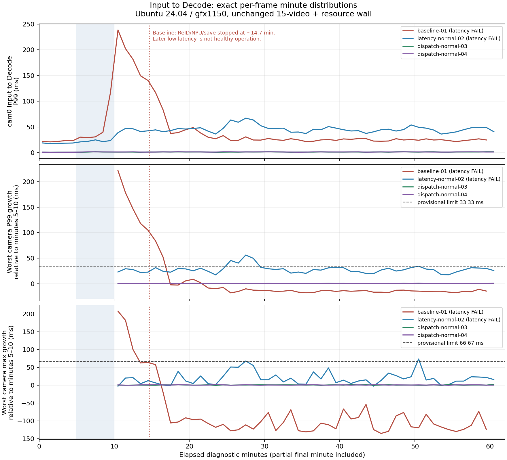

# Input-to-decode latency investigation

## Reading the investigation history

The investigation, plans and experiments below are records of their respective checkpoints. Statements such as “FIFO deferred”, “100 ms FIFO-full failure” and “uncommitted” describe those checkpoints, not the current implementation or working tree. Current live display uses a three-frame FIFO, two-period prefill and oldest-unconsumed replacement on overflow; use the opening policy and [user guide](../../guide/nvr-demo.md) for current behavior. Historical measurements and acceptance outcomes are preserved.

## Live display recovery (2026-11-16)

Live display prioritizes following the latest video. When its three-frame FIFO fills, the oldest entry that has not been consumed is discarded and the new frame is accepted. Initial prefill remains two frame periods. Excessively late queued frames are discarded to catch up; startup burst timing is bounded so scheduled presentation cannot keep moving into the future. Surfaces used by rendering or GPU processing are never reused before completion.

Drops during the first ten seconds after live presentation first starts are excluded from the displayed aggregate. This deadline is shared across cameras and is not extended by reconnecting or resuming presentation. Per-frame diagnostics still retain these drops, with presentation_startup_drop marking their exclusion. After ten seconds, display drops appear as drop N in the single-line tile overlay, as a total in AI Statistics, and as per-camera entries in the ordinary log. Compositor-discarded submissions are accounted separately. latency 10s max covers frames actually presented; a low value alone does not prove that every frame was shown. Recording, retention and AI frequency are unchanged.

Diagnostic analysis with --allow-live-drops reconciles explicit display drops but does not grant all-frames-presented acceptance. The default strict check remains available. Invalid PTS and device failures remain explicit errors. Historical descriptions below of a 100 ms FIFO-full failure and no discards describe the earlier policy; this section supersedes them for current live display.

Direct decoder dispatch independent of recording/database waits passed two full normal runs on Ubuntu 24.04/gfx1150. The observed input-to-decode growth was caused by storage/control-path coupling. Presentation discards at that checkpoint and anonymous RSS growth are recorded separately; the experimental FIFO and Qt comparison below are later work. See the [final review](input-decode-results/dispatch-final-review.json).

The investigation separates receive/assembly delay, input queueing, decoder pad
transit, decoded-frame handoff and presentation. A decoder output timestamp does
not prove VA hardware completion. Existing `Decoded frame wait` and preview scale
measurements must also be inspected. No additional GPU synchronization or pixel
readback is introduced.

## Optional recording

After sourcing `scripts/env.sh`, set `AMDVA_DIAGNOSTICS_DIR` to a new directory and
launch the normal GUI demo. Leaving the variable unset disables this recording.
The demo keeps its configured AI frequency, recording and sysfs GPU metric.
`AMDVA_DIAGNOSTICS_TRACE=0` disables individual frame records while retaining the
same periodic status capture for instrumentation overhead comparisons. Restart
the application to change these settings.

- `events.csv` contains monotonic nanoseconds, source, generation, sequence,
  event name, two event-specific integer values and PTS. Quoted text uses
  backslash escapes; Python readers use `csv.DictReader(..., escapechar='\\', doublequote=False)`.
- Frame events preserve actual zero values and clock/PTS discontinuities rather
  than repairing them. Sources/generations must be compared independently.
- `appsrc_queue` and `ingest_queue` report bytes and frame counts;
  `appsrc_time` and `ingest_oldest_age` report nanoseconds. Unknown age is -1.
- `decoded_lock` reports lock wait, `handoff` reports work while holding that
  lock, and `preview_lock` reports wait and hold. `preview_scale` includes existing
  synchronization in the scale operation, not just execution on the GPU.
- `status.jsonl` records camera progress, existing timing distributions and AI
  completion/queue metrics every five seconds. Timing distributions remain
  rolling observations; exact minute P99 and maxima are computed from frame events.
- A bounded 65,536-event queue is drained by a separate writer thread. Frame
  producers never perform file I/O. The per-run event file limit is 4 GiB.
- `diagnostics-summary.json` is written on clean shutdown and reports accepted,
  written, queue-lost, limit-lost and pending events plus write failure. Missing
  summary, any loss or a write failure invalidates exact frame reconciliation.

`counter` records are diagnostics, not automatically dropped video frames:
in particular, expiry can describe old correspondence metadata. Decoder submission
must be matched to output by source/generation/sequence. Recording-only inputs,
startup, shutdown and existing preview replacement are reported separately.

## Reproduction and acceptance

Use the unchanged 15-camera plus resource tile wall. Preserve source/configuration
hashes and previous evidence before launching: the current GUI clears the previous
recording catalog at startup. Keep original media via hardlinks on the same filesystem
and use SQLite's backup API for a separate catalog snapshot while no NVR runs.

Compare short trace-off/on trials before a 60-minute baseline. Record process CPU,
RSS, DRM allocation, file descriptors, disk I/O and kernel warnings externally.
Compare candidate fixes one at a time, then perform two 60-minute normal-mode runs.
Use minutes 5–10 as baseline: per-camera minute P99 growth must stay within one
input frame period and maximum growth within two periods. Never meet these bounds
by discarding frames or reducing AI frequency. Report existing presentation drops
separately; this does not certify lossless presentation.

FIFO implementation is deferred. Its depth must be based on residual jitter,
explicit overflow behavior and adequate VA surface capacity after fixing drift.
Hardware results and the causal conclusion will be recorded separately; merely
adding diagnostics or failing to reproduce is not a successful fix.

## Audit coverage and VPE execution proof

The GUI starts the requested CPU-copy auditor after model warmup and records its
activation time, live counters and `copy-audit-summary.json` after producers join.
Preloading the library alone does not enable auditing. Earlier GUI investigation
trials that only preloaded it provide no active-copy-audit certification.

`VaSession::crop_scale` requires the submission auditor loaded by `scripts/env.sh`.
One existing VA operation is scoped by display, VA context and destination surface.
Mesa can submit from a worker and share a kernel context between VA contexts;
neither a calling thread nor a kernel context ID identifies an operation reliably.
The auditor instead matches the output binary syncobj on an accepted VPE-only
kernel submission to the caller's existing target-surface completion wait. It also
requires successful `vaBeginPicture` and `vaSyncSurface`, rejects a stale or already
claimed fence, and fails if the supported correspondence cannot be established.
There is no time-counter polling, retry of the scale operation, extra GPU command,
GPU wait or shared GPU lease between models. Metadata is bounded; no image or
indirect-buffer command payload is inspected. Driver paths using unsupported fence
layouts fail explicitly and require validation before being supported.

The audit module is preloaded from a checksum-addressed snapshot belonging to this
checkout. This avoids overwriting a library already loaded by build commands.
A rebuild requires re-sourcing the environment. Direct launches must preserve the
VPE preload when adding the optional CPU-copy auditor. The shared launcher helper
applies the same selection rule to GPU and NPU launches.

`vpe-audit-summary.json` records scoped, completed, failed, aborted and active
operations, accepted/rejected submissions and observer metadata wait time. Run
`python3 scripts/latency/validate_audits.py TRIAL_DIRECTORY` in addition to frame/progress
validation. Final acceptance requires a normal clean exit, at least 60 minutes of
active copy auditing, every VPE scope proved, zero failures and no active scopes
left. A missing summary is an incomplete test. Neither audit replaces the other.

## Causal comparison on amd-rai370

The November 13 investigation first reproduced the delay in a full 60-minute run.
At recording cleanup, `control_quota` reached about 241 ms, holding the control
thread before its next input handoff. The input-to-AU interval remained small;
AU-to-decoder and oldest input age grew. A coincident 600-second media loop alone
was insufficient to identify the cause, so subsequent trials timed cleanup itself.

Metadata payload totals now use transactionally maintained exact counters instead
of repeated whole-table sums. Indexed deletion ranges preserve the original
session/time boundaries. Those changes alone left about 46–64 ms in quota work.
The next candidate groups the same deletes and incremental-vacuum operations into
one transaction with unchanged FULL durability, quota, reserve, retention and
active/playback protection. It commits before the final filesystem-space check,
rolls back metadata on errors, and retains the existing limitation that filesystem
unlinks cannot be rolled back. The first full candidate failed latency acceptance; the later direct-dispatch results are recorded below.

Separate ReID failures came from requiring a VPE busy-time increment within 20 ms.
An isolated real-frame experiment observed 20,000 ROI preparations and 20,001 real
VPE submissions. This motivated the user-approved command/fence audit above;
it does not retrospectively prove every earlier failure was a false alarm.
One candidate also aborted during Wayland shutdown and lacked a clean diagnostic
summary. Short debugger trials did not reproduce that abort; it remains a separate
validation concern, not an established root cause or a successful reconciliation.

## Auxiliary VA contexts and validated scope

Once a VA context enters an audited crop/scale scope, further operations on that
context require their own scope. A conflicting operation targeting an active
audited output is rejected. Independent, unaudited contexts used by the resource
dashboard or encoder retain their existing conversion behavior; their VPE work
cannot prove an audited crop/scale operation. Contracts cover distinct fences on
a shared kernel context and an asynchronous submission worker.

An early prototype incorrectly rejected all unscoped auxiliary work, leaving the
resource tile frozen. Those GUI trials are excluded from normal-wall performance
and acceptance results. The corrected trace-off/on comparison verifies progress
of every visible tile as well as every AI stage. This submission-audit path has
been exercised on Ubuntu 24.04, gfx1150, Mesa 25.2.8; its new audit compatibility
on Ubuntu 26.04/gfx1151 is not established by these results.

## Offline resource review and FIFO handoff

`python3 scripts/latency/summarize_resources.py TRIAL_DIRECTORY` reports baseline and late
RSS, file descriptors, threads, disk I/O and DRM allocation ranges and slopes.
Duplicate file descriptors for a DRM client are counted once. A finite observation
with a small slope is not proof that a process cannot leak. Helper-process exit
and kernel warnings must also be reviewed.

`python3 scripts/latency/size_fifo.py TRIAL_DIRECTORY` requires a clean, loss-free trace.
It separates source generations and measures decoder-output/handoff arrivals after
warmup. It reports PTS discontinuities, arrival intervals, accumulated phase drift,
an initial accumulation time and an observed queue capacity with one scheduling
margin frame. Neither observation point is a hardware-ready fence. Continued
phase drift or insufficient sustained output rate cannot be repaired by a finite
FIFO, and a finite trace does not guarantee a future jitter bound.

The next implementation must retain samples in PTS order without overwriting,
replace the existing latest/newest selection behavior throughout presentation,
and establish a display cadence that can consume every input frame. Specify full
and empty behavior, alarms and backpressure explicitly. Retained VA surfaces need
headroom beyond the decoder DPB for FIFO entries, in-flight scaling and AI readers;
verify the actual GStreamer allocation path before choosing a pool size. Do not
map VA images to CPU memory merely to buffer them. At 2560x1440, tightly packed
NV12 alone is 5,529,600 bytes per frame; alignment, DPB and consumers add overhead.
No FIFO runtime or VA-pool size change is included in this investigation.

Relevant interfaces: [VA memory](https://gstreamer.freedesktop.org/documentation/valib/index.html),
[VA H.265 decoder](https://gstreamer.freedesktop.org/documentation/va/vah265dec.html),
and [GstBuffer lifetime](https://gstreamer.freedesktop.org/documentation/gstreamer/gstbuffer.html).

## First full candidate: failed latency acceptance

`latency-normal-02` ran for 3664.27 seconds on November 13 (17:35:17–18:36:22 JST)
with a normal clean exit. All 45,635,260 diagnostic events were written without
loss. Copy auditing was active for 3648.08 seconds with zero violations; all
2,891,166 VPE scopes completed with zero failure, abort, rejected/foreign operation
or active scope left. All visible sources and four AI stages kept progressing.
No kernel messages were recorded for the interval and owned demo helpers exited.

This is **not an accepted fix**. Exact minute distributions exceeded the unchanged
33.33 ms P99-growth gate during minutes 25–28; the largest growth was 56.13 ms
(cam3, minute 27). Maximum growth also reached 73.74 ms (cam5, minute 50), above
the 66.67 ms gate. Normal exit and good auditing cannot override latency failure.
The second acceptance run has not been started on this failed candidate.

In minute 27, cam0 input-to-AU P99 was 1.29 ms, AU-to-decoder 65.08 ms and decoder
pad-to-pad 5.43 ms. Control quota work reached 130.51 ms and a control iteration
142.51 ms; preview lock hold P99 was 0.79 ms. In this failed candidate, input dispatch ran after
quota enforcement and recorder polling on the same control path. Moving quota
alone to a worker can still leave recorder metadata waiting on the catalog lock.
The user subsequently approved separating decoder input from recording/database
waits; the implementation and short verification are described below. Retention, deletion boundaries,
AI frequency, host and SDK remain unchanged. Post-decode FIFO implementation is
still deferred, and two passing full runs remain required after the next fix.

Anonymous RSS grew by about 56 MiB over minutes 20–60 (slope about 1.33 MiB/min).
File-backed RSS was constant, and DRM allocation changed only slightly. This is
an unresolved observation, not evidence of a memory plateau or a proven leak.

Of 2,004 high-latency frames in minutes 25–28, 1,923 (95.96%) overlapped quota work during AU-to-decoder waiting; the overlap covered 86.12% of their total wait. High latency here means exceeding the source baseline P99 by 33.33 ms, not a dropped frame. Non-overlapping waits are not attributed to quota work by this observation.

Evidence: [candidate report](input-decode-results/latency-normal-02/trial-report.json), [control overlap](input-decode-results/latency-normal-02/control-overlap.json), [resource trends](input-decode-results/latency-normal-02/resource-analysis.json), and [plot reproduction](input-decode-results/reproduce-plot.txt). Existing non-presented visible-video dispositions include 173,680 latest replacements and 62,211 preview discards; they are not unexplained decode losses and do not certify lossless presentation.

## Approved direct dispatch and short verification

The user approved separating decoder input from recording/database waits.
RtspIngest::on_sample now dispatches compressed sample references on the receive
thread, outside the recording-queue lock. The running path never dereferences a
recorder or calls SQLite. An ingest sequence independent of optional telemetry
orders bootstrap and live callbacks; the first keyframe cannot be submitted twice
when the control consumer sees it before the receive callback. A bounded 16 MiB
encoded queue exists only during startup/rebinding. Full queues backpressure the
producer; they do not overwrite queued access units. This is not the deferred
post-decode presentation FIFO.

Decoder/transcoder destruction first quiesces dispatch. The recording owner
publishes a PTS/wall-clock/session anchor after its first successful push; the
receive path uses that bounded snapshot. Transcoder input/output timing maps have
short mutexes so one producer can run independently of output collection. Quota,
reserve, retention, segment length, protection, AI frequency and host SDKs remain
unchanged. This investigation's normal demo does not enable transcoding; do not
interpret its hardware results as new validation of every transcoding mode.

At shutdown, pre-cutoff RTP groups get up to 500 ms to reach the AU probe; a timeout
is a validation failure. Decoder appsrc EOS drains submitted frames before NULL,
with a two-second per-decoder bound. Unassembled RTP groups, complete queued AUs,
and existing presentation releases are separate dispositions. An RTP retirement
cannot excuse a complete AU or input first observed before the shutdown request.
The request timestamp is captured before notifying worker threads. These shutdown
waits do not add a GPU synchronization operation to normal frame processing.

dispatch-pilot-01 exposed one input-only RTP group first observed 39.16 ms after
the stop request. It remains an incomplete original trial; it is not retrospectively
certified by guessing a disposition. Explicit receive retirement and drain checks
were then added. dispatch-pilot-02 passed full reconciliation, visible-source and
four-stage AI progress, and both audits: 1,549,099 diagnostic records, zero loss,
with per-camera minute P99 about 1.16–1.94 ms. Audit coverage for short trials is
checked against 90 seconds; final acceptance still requires 3600 seconds.

The final 43 contract tests passed, including bootstrap echo/order, bounded
backpressure, concurrent lifecycle, explicit failure, recording clock, real
synthetic RTP assembly/audio, and invalid-retirement/drain rejection. A sequential
120-second trace-off/on pair also passed progress and audits, and the on trial
reconciled all 1,555,910 records. Observed changes: CPU +0.0061 core, AI rate
-0.064%, decode rate +0.0024%, display +0.128%, ReID P95 +8.01%, YOLO P95 -2.59%.
A single short pair includes temporal variance and does not establish zero cost.

The original ingest_queue/oldest-age observations now describe recording/control
backlog, not decoder dispatch backlog. Use decode_dispatch_queue,
decode_dispatch_oldest and decode_dispatch_wait with decoder input/output
identities to distinguish them. A long recording queue no longer means the
same AU waited there before decode. The two completed normal runs are reported below.

## Completed-AU shutdown diagnostic correction

The first direct-dispatch full run passed. The second (dispatch-normal-02) stayed
within the latency bounds but failed reconciliation for cam11 generation 27,
sequence 109383. Input and AU observation were 50.28/50.99 ms after stop. The AU
had reached the appsink pad before the receiver NULL transition flushed it; no
application callback/queue retirement existed for that sample. The original
trial remains failed, without retrospective certification by a guessed disposition.

receive_au_closed now records the receiver correspondence table closing after
the pipeline has stopped. It does not claim all closed groups were discarded.
Only an otherwise-unsubmitted complete AU first received after the shutdown
request, with explicit closure after AU observation, becomes shutdown_au_retired.
Pre-stop inputs, incomplete RTP and AUs without closure remain failures. Existing
packet paths and discard policy are unchanged. A real GStreamer fixture observes
an AU but never pulls it from appsink before NULL; negative tests cover pre-stop
input, missing closure/AU and reversed closure time. All 43 contracts passed.

The final 120-second trace-off/on pair passed progress and both audits. Trace-on
matched all 1,559,585 records without loss. Changes were CPU +0.0194 core, AI rate
+0.0257%, decode +0.00077%, display -0.0144%, ReID P95 -1.97%, YOLO P95 -0.369%.
These sequential short observations do not prove zero instrumentation overhead.
Two new full normal runs follow this diagnostic correction.

## Final direct-dispatch acceptance: two full runs passed

Both normal runs used identical source file contents/modes, binary, build libraries,
launcher, runtime inputs and UI layout. Compressed source-archive hashes differ
because their gzip headers have different creation times; per-member SHA256 and
modes, plus the tracked patch hash, establish source identity. No host/SDK, media,
AI cadence, retention/deletion setting or frame-discard policy changed between runs.

| Run | Elapsed s | Loss-free diagnostic records | Worst P99 growth ms | Worst maximum growth ms | Late absolute P99 ms | Late absolute maximum ms |
| --- | ---: | ---: | ---: | ---: | ---: | ---: |
| dispatch-normal-03 | 3669.64 | 51,446,081 | 0.784 | 2.563 | 2.928 | 5.782 |
| dispatch-normal-04 | 3664.37 | 51,345,347 | 1.034 | 1.839 | 2.843 | 5.538 |

All 16 video sources covered at least 3600 seconds each. All complete access units first received before shutdown
matched decoder submission/input/output/handoff; every submitted AI request
completed. The resource tile and every AI stage kept progressing. No unexplained
frame disposition, receive/decoder-drain failure, CPU-copy violation or failed,
aborted, foreign or active VPE scope remained. Copy auditing covered over 3600
seconds in each run. Owned RTSP/dashboard helpers exited. Kernel findings are preserved in each run's
kernel.txt and review-summary.json; no GPU reset/fault was observed. Any listed
local TCP, file-release worker or cupsd AppArmor warnings remain separate observations; no host
tuning was applied. Explicit partial RTP and complete-AU cancellations first observed after the stop
request are separate dispositions. Partial-RTP retirement never excuses a complete
AU, and neither disposition excuses a pre-stop missing input.

Quota work still occurs, but no longer blocks the next AU's decoder submission.
Together with the earlier AU-to-decoder/quota overlap and the failed optimization-only
candidate, this controlled comparison supports storage/control-path coupling as the
cause of the observed input-to-decode growth on this configuration. It does not
attribute every possible future latency spike to the same cause.

Evidence: [final review](input-decode-results/dispatch-final-review.json),
[first run](input-decode-results/dispatch-normal-03/trial-report.json),
[second run](input-decode-results/dispatch-normal-04/trial-report.json),
[source contents](input-decode-results/dispatch-source-content-sha256.json).
Raw CSV, SQLite snapshots and media stay outside Git. Archive manifests, verified
local backups and relocation pointers preserve their size/hash/location history.

### Remaining limits

- dispatch-normal-03: visible-video latest replacements 98, preview discards 56,001; anonymous RSS grew 51.59 MiB in minutes 20–60 (slope 1.25 MiB/min). Hidden cam15 replacements are separate. This is neither lossless-display certification nor proof of a memory plateau.
- dispatch-normal-04: visible-video latest replacements 207, preview discards 56,958; anonymous RSS grew 60.91 MiB in minutes 20–60 (slope 1.56 MiB/min). Hidden cam15 replacements are separate. This is neither lossless-display certification nor proof of a memory plateau.

The VPE-audit driver correspondence has been newly validated only on this Ubuntu
24.04/gfx1150/Mesa environment. Ubuntu 26.04/gfx1151 and non-demo transcoding modes
need separate hardware validation. No FIFO runtime or automatic commit/push is included.

## Next-stage FIFO implementation plan

1. Recheck actual VA-ready arrival jitter using existing completion points without
   introducing diagnostic GPU waits or CPU image copies. The current loss-free
   pad-output/handoff traces require at most **3 queued frames**, with
   **2 periods (66.67 ms) of initial accumulation**;
   the largest visible-video output interval is **41.32 ms**.
   These are finite-trace estimates including one scheduling-margin frame, not a
   guaranteed bound. Full per-source/generation PTS and drift statistics are in
   each run's fifo-sizing.json.
2. Start the design from that measured depth, then size the actual VA pool for
   decoder DPB + FIFO + at least one producer output surface + unique in-flight
   preview/AI surfaces and allocator minimums. At the observed queue depth, reserve
   at least 4 surfaces above the DPB before counting other consumers.
   Queued tightly packed 1440p NV12 alone would use **237.3 MiB across 15
   videos** at that depth. Alignment and all other consumers add overhead.
   Validate the actual GStreamer allocator/pool controls before changing them.
3. Replace latest/newest selection throughout the decode-to-presentation path
   with a PTS-ordered, generation-aware queue of retained GPU samples. A 30 fps
   presentation cadence must consume every input frame; a faster refresh display
   can repeat an already-presented frame on unused refreshes without consuming
   or skipping a new input. Match frame identities to actual presentation completion
   as well as draw/swap; swap alone is not scanout proof. Bound any reorder window
   and log PTS discontinuities. Never hold the FIFO mutex during GPU work or
   consumer completion waits; bounded producer waits must release that mutex.
4. Full means bounded backpressure plus an explicit overflow/latency alarm and
   eventual explicit failure, never overwrite/drop. Empty means repeat the last
   displayed image and record an underrun; never synthesize a successful new-frame
   presentation. Stop/reconnect drains or retires frames with explicit IDs.
5. First prove sustained 30 fps with AI, recording and search enabled. A finite FIFO
   cannot fix a permanent consumer throughput deficit. Test full/empty, reorder,
   loop/reconnect, stop, surface exhaustion and one-frame accounting; then repeat
   long normal trials and require every frame either displayed or explicitly
   reported as a failed requirement. The existing display discards must disappear
   before claiming the user's no-frame-loss requirement has been met.

This is a proposal for the next implementation, not authorization to change the
display policy or a claim that a 3-frame queue alone fixes presentation.

## Experimental decoded presentation FIFO (2026-11-14)

The Qt scheduling comparison passed on Ubuntu 24.04/gfx1150, but this is **not
long-duration FIFO acceptance**. The earlier two full input-to-decode acceptance
runs apply to `1c38061`, before the FIFO. Later work remains uncommitted on
`codex/pts-presentation-fifo`; no push or release was made.

The live path holds three decoded VA samples per visible source and prefills two
frame periods. It consumes PTS order without overwriting admitted frames.
Allocation asks for four extra decoder surfaces (three retained plus producer);
observed HEVC pool minimum is 12, resource H.264 minimum 10 (maximum remains the
existing dynamic allocator policy). Ready BGRA images are consumed oldest first.
A surface cannot be reused until its existing GL fence and physical presentation
acknowledgement, or an explicitly recorded lifecycle retirement, allow it.
FIFO-full waiting is bounded at 100 ms. Admission more than four frame periods
behind its PTS deadline is also an explicit error, catching sustained backlog
which could otherwise grow while each full wait stays below 100 ms.

A swap or a discarded Wayland commit is not a unique displayed/lost video frame.
`presented` records one source/generation/sequence confirmed by Wayland
`wp_presentation` v1. Several commits may contain that same picture. Ordinary
unpresented frames, unavailable feedback or FIFO failure produce explicit errors.
No decoded pixel readback, new per-frame GPU synchronization, AI frequency cut,
SDK replacement or host/compositor setting change was added. Playback keeps its
previous policy; user suspension is separate from lossless normal live operation.

| Trial | Observation | Result |
| --- | --- | --- |
| fifo-pilot-01 | Current-picture ACK plus Qt refresh waits serialized rendering; cam0 input-to-decode reached 23.5 s | Failed |
| fifo-pilot-02 | Pipelining restored most latency P99 values to 1–2 ms, but cam13 generation 29 sequence 1423 was never shown and retained a plane | Failed |
| fifo-pilot-03 | Two submitted refreshes reduced throughput to 29.78 fps; growing delay and startup FIFO timeout | Failed |
| fifo-pilot-04 | Nonblocking swap alone retained Qt's separate update-delivery wait; delay grew to about 1.5 s | Failed |
| fifo-pilot-05 | Immediate Qt update delivery removed growing delay; 93 shutdown-tail frames remained unclassified | Failed reconciliation |
| fifo-pilot-06 | 52,134 decoded = 52,061 actually presented + 73 explicitly retired at shutdown | Passed 120-second comparison |
| fifo-normal-01 | 412,353 decoded = 412,286 actually presented + 67 explicitly retired at shutdown | Passed 15-minute comparison |

The user approved changing application-side presentation scheduling. Live windows
request nonblocking swaps. When a due image is ready and its predecessor is
confirmed, a 4 ms precise timer queues GUI-thread delivery of Qt's ordinary update
request through `QPlatformWindow::deliverUpdateRequest`. This preserves Qt's
framebuffer/resolve/swap path while removing its additional Wayland frame-callback
wait. The next image still requires actual presentation acknowledgement.
See the official [Qt swap interval documentation](https://doc.qt.io/qt-6/qsurfaceformat.html#setSwapInterval),
[Qt 6.4.2 Wayland update delivery](https://github.com/qt/qtwayland/blob/v6.4.2/src/client/qwaylandwindow.cpp)
and [Qt platform delivery](https://github.com/qt/qtbase/blob/v6.4.2/src/gui/kernel/qplatformwindow.cpp).

Shutdown is marked before window hiding/teardown. Retired frames are not counted
as shown. `scripts/latency/validate_presentations.py` requires physical-feedback
mode, every visible source, matching per-frame submission timestamps, complete
diagnostics and explicit fresh shutdown dispositions. A stale lost picture cannot
be excused by retirement at shutdown. Fixed-layout validation does not accept
unannounced mid-run suspension as successful presentation.

During the 15-minute run, compared with minutes 5–10, the largest later per-minute
input-to-decode P99 growth was **0.752219 ms** and maximum-value growth was
**3.903067 ms**, within the provisional 33.33/66.67 ms growth bounds. The run
included **1,036 retention deletions**. All four AI stages progressed; copy/VPE
completion audits passed, with zero copy violations. No diagnostic records were
lost and no ordinary visible-frame loss was excused. Hidden cam15 retains its
existing AI/latest policy and is excluded from visible-frame presentation claims.
See [growth evidence](presentation-fifo-results/fifo-comparison-growth.json) and
[physical reconciliation](presentation-fifo-results/fifo-normal-01-physical.json).
These results do not replace a 60-minute trial, two-run acceptance or a claim that
anonymous RSS growth has been fixed.

A separate `amdva-presentation-lifecycle CONFIG.json RESULT.json` hardware tool
checks hold/resume, hide/show, focus/grid and camera switch/restore using the
normal backend and per-slot actual presentation counts. The first lifecycle run
found a source-intent race: layout arrived before asynchronous camera assignment,
so the new camera inherited the old slot's hidden state. Requested source IDs
are now retained independently and reapplied under the slot lock when binding.
Old-generation surfaces retire explicitly, without reuse before their GL fence.
The second functional run passed, but its harness had not enabled copy-audit
startup; it is not copy-audit evidence. The next run correctly failed on missing
preloaded auditor hooks. The hardware tool now requires active copy auditing and
complete VPE scopes; the corrected harness exports `AMDVA_COPY_AUDIT=1` before
sourcing `scripts/audit-env.sh --copy`, so hooks are loaded before process start.
The subsequent audited run passed. Its declared pauses are not a fixed-layout
lossless acceptance trial. The hardware tool needs the same prepared models,
RTSP/dashboard services and host/NPU environment as the normal demo; it does not
install those or change the normal launcher.

The approved OS-native development additions were nine packages, with no
upgrades/removals; [installed versions](presentation-fifo-results/installed-dev-packages.json)
include Qt private headers matching 6.4.2 and `wayland-protocols`. The dependency
lock now lists `qt6-base-private-dev`, `libwayland-dev` and `wayland-protocols` as
host build prerequisites. Private QPA headers must match the installed Qt. Never
extract Ubuntu 24.04 Qt libraries onto 26.04. The reference compositor exposes
`wp_presentation` v1 but no FIFO/commit-timing manager; this is capability evidence,
not an impossibility proof. X11 and Ubuntu 26.04/gfx1151 remain unvalidated for
this new physical-feedback path. CPU contracts, normal-run evidence and
interactive evidence are separate; none alone proves all supported environments.

Raw source/config/binary hashes and diagnostics remain under
`/home/amd/work/rai/logs/presentation-fifo-20261114/`. Compact evidence and analyzer
provenance are in `presentation-fifo-results/`. No automatic commit/push was made.

The final 120-second normal regression after source-selection fixes also passed:
51,663 decoded = 51,586 physically presented + 77 fresh shutdown retirements;
copy auditing and all 95,372 VPE scopes completed without violations/failures.
The final CPU suite passed all 47 contracts. The optional diagnostic logging path
and the interactive lifecycle tool are validated separately.

With `AMDVA_DIAGNOSTICS_DIR` unset, the separate lifecycle run also passed using
in-memory per-slot physical-presentation counters. Diagnostic logging is not
required for FIFO operation. This is a functionality check, not a quantified
instrumentation-overhead comparison.

## GPU-ready observation added on 2026-11-16

The historical input_decode and decoder metrics in this investigation remain CPU
decoder pad transit metrics. They are preserved so earlier latency-growth trials
retain their original meaning. A 45-second output-status probe found 12,987 of
12,997 output notifications still VASurfaceRendering, with only 10 already Ready.

AI Statistics now uses input_decode_ready, measured to a nonblocking
vaQuerySurfaceStatus Ready observation after decoder output. decoder_ready uses
the decoder sink-pad timestamp as its start. A single worker polls at a nominal
1 ms interval, retains the exact GstBuffer and GstVaDisplay, and limits outstanding
observations globally to 64 with a 1-second timeout. No vaSyncSurface, GPU command,
pixel map or readback is added. Failures affect measurement coverage, not frame
admission: recent incomplete input-to-ready windows display N/A for ten seconds.
The separate decode_ready_uncertainty distribution records the actual interval
between the preceding not-ready query (or output notification) and ready observation.
This is an upper-bound observation of output availability, not a GPU execution timer.

AMDVA_DECODE_READY_OBSERVE=0 disables the observer for diagnostic overhead
comparisons; ready latency remains unavailable rather than using the old endpoint.
Missing input identity, stale generations, duplicate observations and readiness
arriving after draw/swap have dedicated regression coverage. Offline analysis
reports the old and new metrics separately. See
[short comparison results](decode-ready-latency-results.json). Short tests do not
establish long-duration reliability or zero overhead.

In the single sequential 90-second off/on comparison, application CPU usage after warmup was about 1.97 versus 2.20 cores (difference 0.23 core). Both trials sustained frame/AI progress, passed physical-frame reconciliation and short-run audits. This is evidence of nonzero observer cost, not a noise-controlled overhead bound or long-duration acceptance result.
